# SAE-Gated RAG: Deciding to Answer, Retrieve, or Abstain Before Generation

**LMA Group Project (final submission)**  
**Team:** Gopal Kataria (2023112006) · Manya Jain (2024102068) · Nidhi Vaidya (2023114005) · Salvik Krishna (2023113015)


**[Final report (PDF)](report/final/final_report.pdf)** · **[Final evaluation](results/final/final_summary.md)** · **[Gate summary](results/final/gate_summary.json)**

## What the project does

A frozen **Gemma 3 4B Instruct** model processes a question without generating answer tokens. A lightweight, class-weighted logistic-regression probe then chooses **ANSWER** (answer directly), **RETRIEVE** (BM25 top-3 passages, then answer), or **ABSTAIN** (decline). We compare probes on **Gemma Scope 2 sparse autoencoder (SAE) features** against probes on the original **dense residual-stream activation**, plus routing baselines.

The primary configuration uses `sae16k_last@L29` for the SAE router and `resid_last@L22` for the dense comparator, with the `miss_as_retrieve` label rule. Primary layers and decision thresholds were selected on NQ/TriviaQA **validation**, not test, examples.

## Headline results

The primary evaluation uses **4,000 answerable test questions** from Natural Questions, TriviaQA, PopQA, and HotpotQA; the latency test uses 200 questions. See the [report](report/final/final_report.pdf) for definitions and experimental caveats.

| Measurement | SAE L29 | Comparator |
|---|---:|---:|
| End-to-end answer accuracy | 31.525% | Always retrieve: 31.875% |
| BM25 retrieval call rate | 49.175% | Always retrieve: 100% |
| Mean per-dataset action macro-F1 (probe grid) | 45.8% | Selected dense L22: 48.2% |
| Composed latency, median / p95 | 234.4 / 466.6 ms | Always retrieve: 231.3 / 492.8 ms |

The 200-item strict label audit found **15 errors (7.5%)**, with a 95% Wilson interval of about 4.6–12.0%. SAE routing meets the prespecified retrieval-efficiency target, but the dense probe leads on primary macro-F1, and SAE does not beat always-retrieve on median latency. Abstention reduces wrong answers under simulated retrieval holes, at the expense of answer coverage. We report these negative and mixed findings rather than redefining the hypotheses.

## Project Pipeline

```mermaid
flowchart LR
    Q([Question])

    subgraph PASS [Frozen model: one forward pass, no answer tokens]
        LLM[Gemma 3 4B Instruct]
        H[Last-token residual<br/>activation h_L]
        LLM --> H
    end

    subgraph FEAT [Probe inputs]
        SAE[Gemma Scope 2 SAE<br/>16k sparse features z_L<br/>primary, layer 29]
        DENSE[Dense residual<br/>raw h_L<br/>comparator, layer 22]
    end

    PROBE{{Logistic-regression probe<br/>class-weighted,<br/>validation-tuned thresholds}}

    A[ANSWER<br/>generate directly]
    R[RETRIEVE<br/>BM25 top-3, then answer]
    X[ABSTAIN<br/>decline or hand off]
    W[(DPR Wikipedia<br/>21M passages)]

    Q --> LLM
    H --> SAE
    H -.-> DENSE
    SAE --> PROBE
    DENSE -.-> PROBE
    PROBE --> A
    PROBE --> R
    PROBE --> X
    R -.-> W

    classDef input fill:#fef3c7,stroke:#f59e0b,stroke-width:2px,color:#78350f
    classDef frozen fill:#1e293b,stroke:#0f172a,stroke-width:2px,color:#f8fafc
    classDef act fill:#e0e7ff,stroke:#6366f1,stroke-width:2px,color:#312e81
    classDef sae fill:#ccfbf1,stroke:#0d9488,stroke-width:3px,color:#134e4a
    classDef dense fill:#dbeafe,stroke:#3b82f6,stroke-width:2px,stroke-dasharray:5,color:#1e3a8a
    classDef probe fill:#ede9fe,stroke:#7c3aed,stroke-width:3px,color:#3b0764
    classDef answer fill:#dcfce7,stroke:#16a34a,stroke-width:2px,color:#14532d
    classDef retrieve fill:#e0f2fe,stroke:#0284c7,stroke-width:2px,color:#0c4a6e
    classDef abstain fill:#fee2e2,stroke:#dc2626,stroke-width:2px,color:#7f1d1d
    classDef db fill:#f1f5f9,stroke:#64748b,stroke-width:2px,color:#334155

    class Q input
    class LLM frozen
    class H act
    class SAE sae
    class DENSE dense
    class PROBE probe
    class A answer
    class R retrieve
    class X abstain
    class W db

    style PASS fill:#f8fafc,stroke:#94a3b8,stroke-width:2px,stroke-dasharray:6,color:#334155
    style FEAT fill:#fafaf9,stroke:#a8a29e,stroke-width:2px,stroke-dasharray:6,color:#44403c

    linkStyle 2 stroke:#0d9488,stroke-width:3px
    linkStyle 3 stroke:#3b82f6,stroke-width:2px
    linkStyle 4 stroke:#0d9488,stroke-width:3px
    linkStyle 5 stroke:#3b82f6,stroke-width:2px
    linkStyle 6 stroke:#16a34a,stroke-width:3px
    linkStyle 7 stroke:#0284c7,stroke-width:3px
    linkStyle 8 stroke:#dc2626,stroke-width:3px
    linkStyle 9 stroke:#94a3b8,stroke-width:2px
```


## Setup and quick verification

Requires Python (version specified in `.python-version`) and [`uv`](https://docs.astral.sh/uv/). From the repository root:
> we used an *ml.g6.2xlarge (NVIDIA L4, 32GBvRAM)* instance on AWS SageMaker AI 
```bash
uv sync
uv run pytest -q
uv run python scripts/finalize_project.py
```

`pyproject.toml` and `uv.lock` pin the project dependencies. For GPU feature extraction, use a compatible NVIDIA CUDA environment, model access, and `uv sync --extra features`. The full archived experiments also require original Hugging Face checkpoints and their model/SAE caches.

The finalizer writes `results/final/gate_summary.json`, `results/final/final_summary.md` and supporting CSVs. **It can audit committed exports without raw model features**; inspect provenance/availability fields because an export-only audit is *not* a full reproduction of training or generation.

## Repository guide

| Location | Contents |
|---|---|
| [`report/final/`](report/final/) | Submitted PDF, `main.tex`, bibliography, editable TikZ workflow, chart PDFs, and chart-generation script |
| [`results/final/`](results/final/) | Gate 0–3 / H1–H4 final audit and tabular results |
| [`results/analysis/`](results/analysis/) | Corrected paired bootstrap, selected-model comparison, confusion and error analyses |
| [`results/sagemaker/`](results/sagemaker/) | Probe/score exports and measured L29 SAE / L22 dense latency components |
| [`scripts/sagemaker/`](scripts/sagemaker/) | GPU measurement and latency-routing scripts |
| [`docs/SELECTED_LATENCY_SAGEMAKER.md`](docs/SELECTED_LATENCY_SAGEMAKER.md) | Exact selected-controller GPU procedure |
| [`artifacts/retrieval/`](artifacts/retrieval/) | Compressed Wikipedia retrieval handoff |
| [`report/report_mid.pdf`](report/report_mid.pdf) | Historical mid-evaluation report, **not** the final submission |

## Reproducing the statistical analysis

Given the canonical question-level labels/generations and saved router probabilities in `data/questions/`, `data/labels/`, `data/generations/`, and `runs/routers/`, rerun the analyses:

```bash
uv run python scripts/analysis/selected_model_bootstrap.py
uv run python scripts/analysis/bundle_analysis.py
```

**Important:** Large raw question-level feature tensors and caches are not part of a standard Git clone; the Git-tracked summaries alone are not sufficient to refit probes or recompute bootstrap intervals from scratch. The original 4B generation and feature-extraction artifacts must be obtained from the team's archived SageMaker outputs. Do not substitute derived CSV exports for missing raw examples.

## Main experimental configuration
- **Data:** Natural Questions and TriviaQA, each 4,000 train / 500 validation / 1,000 test; PopQA (1,000), HotpotQA (1,000), SelfAware (500 unanswerable), plus a 500-question pilot sampled from training questions; seed 13. **13,500 unique questions** in the main inventory, excluding the pilot duplicates.
- **Retrieval:** 2018 DPR-style Wikipedia, **21,015,324 passages** and 22 Pyserini/Lucene BM25 shards; score top-100, supply top-3. A lexical query-time filter simulates holes; it does **not** physically delete documents.
- **Generation:** `unsloth/gemma-3-4b-it`, greedy decoding with up to 32 new tokens; corrected answer matching and `miss_as_retrieve` labels. See `configs/sagemaker.yaml`.
- **Probe inputs:** Gemma Scope 2 residual-post JumpReLU SAE, width 16,384; dense residual-stream baseline. Candidate layers 9, 17, 22, 29; class-weighted logistic regression, three-fold hyperparameter selection.
- **Latency:** NVIDIA L4, batch size 1, first 100 NQ + 100 TriviaQA test questions. `scripts/sagemaker/latency_selected_measure.py` and `latency_selected_route.py` measure selected SAE L29 and dense L22. End-to-end latency is **composed from measured stages and BM25 timings**, not a directly instrumented online serving request.
