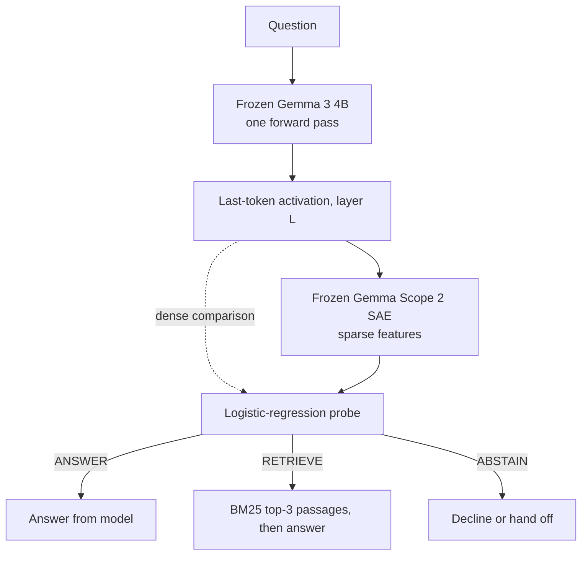

# SAE-Gated RAG

A frozen LLM reads only the question. A probe on its SAE features (or on the dense activation) picks **ANSWER**, **RETRIEVE** or **ABSTAIN** before any retrieval or generation happens.



## Setup

```bash
uv sync                      # core: data, labels, probes, metrics (CPU)
uv sync --extra features     # + torch, transformers (needed for extraction)
uv run pytest
```

Gemma 3 is gated on Hugging Face: accept the licence, then run `hf auth login`.

## Running

**Laptop (CPU, Gemma 3 1B, plumbing check only):**

```bash
bash scripts/local_pilot.sh          # about 40 minutes; LIMIT=100 for a shorter run
```

**IIIT ADA (Gemma 3 4B, GPU):**

```bash
rsync -av --exclude .venv --exclude /data --exclude /runs ./ <user>@ada.iiit.ac.in:saerag-proj/
ssh <user>@ada.iiit.ac.in
cd saerag-proj
bash scripts/ada_run.sh pilot        # Gate 0 run on the pilot, about an hour
bash scripts/ada_run.sh full         # all splits, then the CPU probe grid
```

Set `ACCOUNT=`, `PARTITION=` and `GPUS=` as environment variables if the defaults do not fit. Results are written to `runs/`.

## Who did what

| Area | Owner |
|------|-------|
| BM25 index, retrieval tool, index-hole construction | Nidhi |
| Generation and labelling pipeline: three conditions, answer matching, label rule | Manya |
| Activation and SAE extraction, probe training and evaluation | Gopal |
| Baselines B1–B4 and B8, metrics code, hand-checking labels | Salvik |
