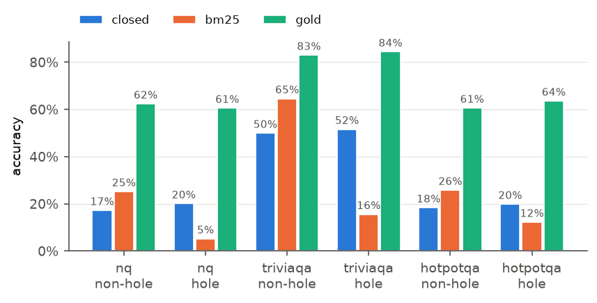
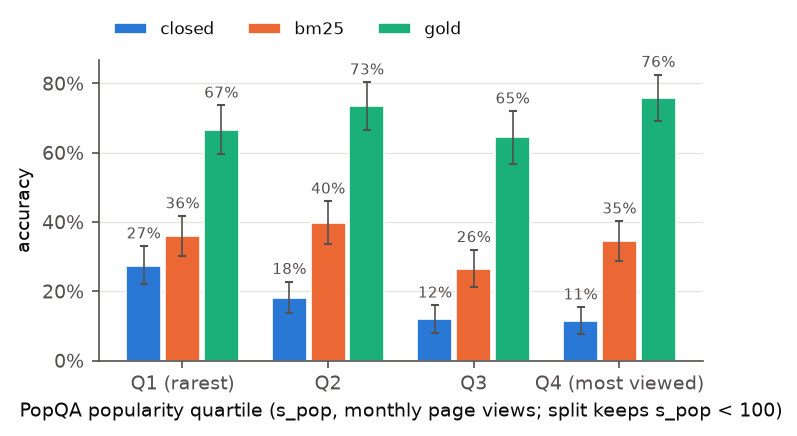

# Failure analysis (gemma3-4b-it, rule: miss_as_retrieve)

Failure types:

- **known, RAG keeps it**: closed right, BM25-RAG right
- **RAG hurts**: closed right, BM25-RAG wrong
- **RAG fixes**: closed wrong, BM25-RAG right
- **reader failure**: closed and RAG wrong, but the BM25 passages contain the answer
- **retriever miss**: closed and RAG wrong, passages lack the answer, gold passage works
- **beyond model**: wrong even with the gold passage
- **no gold passage**: closed and RAG wrong, passages lack the answer, no gold stand-in
- **unanswerable**: Self-Aware: no answer exists

## Failure types (share of questions)

| subset | n | known, RAG keeps it | RAG hurts | RAG fixes | reader failure | retriever miss | beyond model | no gold passage | unanswerable |
|---|---|---|---|---|---|---|---|---|---|
| all test | 4500 | 12.8% | 10.5% | 15.1% | 6.4% | 16.9% | 14.1% | 13.2% | 11.1% |
| nq | 1000 | 6.8% | 11.3% | 12.2% | 7.9% | 22.5% | 20.9% | 18.4% | 0.0% |
| triviaqa | 1000 | 29.7% | 20.7% | 21.0% | 3.1% | 14.7% | 5.4% | 5.4% | 0.0% |
| popqa | 1000 | 12.3% | 4.9% | 21.8% | 7.3% | 8.4% | 9.5% | 35.8% | 0.0% |
| hotpotqa | 1000 | 8.6% | 10.2% | 13.1% | 10.3% | 30.3% | 27.5% | 0.0% | 0.0% |
| selfaware | 500 | 0.0% | 0.0% | 0.0% | 0.0% | 0.0% | 0.0% | 0.0% | 100.0% |
| nq hole=False | 691 | 8.7% | 8.5% | 16.5% | 11.4% | 17.8% | 18.4% | 18.7% | 0.0% |
| nq hole=True | 309 | 2.6% | 17.5% | 2.6% | 0.0% | 33.0% | 26.5% | 17.8% | 0.0% |
| triviaqa hole=False | 717 | 35.8% | 14.1% | 28.7% | 4.3% | 7.7% | 4.0% | 5.3% | 0.0% |
| triviaqa hole=True | 283 | 14.1% | 37.5% | 1.4% | 0.0% | 32.5% | 8.8% | 5.7% | 0.0% |
| hotpotqa hole=False | 698 | 9.2% | 9.2% | 16.6% | 14.8% | 25.2% | 25.1% | 0.0% | 0.0% |
| hotpotqa hole=True | 302 | 7.3% | 12.6% | 5.0% | 0.0% | 42.1% | 33.1% | 0.0% | 0.0% |

CSV: `failure_types.csv`

## When retrieval hurts (closed right, BM25-RAG wrong)

| dataset | hole | n | closed right | RAG hurts | hurt share of known | hurt with answer in passages |
|---|---|---|---|---|---|---|
| nq | False | 691 | 119 | 59 | 49.6% | 15 |
| nq | True | 309 | 62 | 54 | 87.1% | 0 |
| triviaqa | False | 717 | 358 | 101 | 28.2% | 33 |
| triviaqa | True | 283 | 146 | 106 | 72.6% | 0 |
| popqa | False | 1000 | 172 | 49 | 28.5% | 22 |
| hotpotqa | False | 698 | 128 | 64 | 50.0% | 16 |
| hotpotqa | True | 302 | 60 | 38 | 63.3% | 0 |

CSV: `rag_hurts.csv`

## PopQA popularity quartiles (Spearman s_pop vs closed-book correct: -0.165; 95% bootstrap CIs)

| bin | s_pop range | n | closed | closed lo | closed hi | bm25 | bm25 lo | bm25 hi | gold | gold lo | gold hi | ANSWER | RETRIEVE | ABSTAIN |
|---|---|---|---|---|---|---|---|---|---|---|---|---|---|---|
| Q1 (rarest) | 2-49 | 254 | 27.2% | 22.0% | 33.1% | 35.8% | 30.3% | 41.7% | 66.7% | 59.6% | 73.7% | 27.2% | 27.6% | 45.3% |
| Q2 | 50-67 | 250 | 18.0% | 13.6% | 22.8% | 39.6% | 33.6% | 46.0% | 73.4% | 66.5% | 80.4% | 18.0% | 33.2% | 48.8% |
| Q3 | 68-82 | 250 | 12.0% | 8.0% | 16.0% | 26.4% | 21.2% | 32.0% | 64.7% | 56.7% | 72.0% | 12.0% | 30.4% | 57.6% |
| Q4 (most viewed) | 83-99 | 246 | 11.4% | 7.7% | 15.4% | 34.6% | 28.9% | 40.2% | 75.8% | 69.1% | 82.6% | 11.4% | 38.2% | 50.4% |

CSV: `popqa_bins.csv`

## HotpotQA by level and question type

| by | value | n | closed | bm25 | gold |
|---|---|---|---|---|---|
| level | hard | 1000 | 18.8% | 21.7% | 61.5% |
| qtype | bridge | 773 | 10.6% | 16.6% | 60.0% |
| qtype | comparison | 227 | 46.7% | 39.2% | 66.5% |

CSV: `hotpotqa.csv`

## Answer-matching near misses (token F1 >= 0.5, not counted correct) and the miss_as_retrieve labels they would change

| split | n | near misses closed | near misses bm25 | near misses gold | labels that would change |
|---|---|---|---|---|---|
| nq_test | 1000 | 60 | 76 | 54 | 11.5% |
| triviaqa_test | 1000 | 54 | 48 | 31 | 7.3% |
| popqa_test | 1000 | 31 | 25 | 18 | 4.7% |
| hotpotqa_test | 1000 | 65 | 71 | 163 | 18.9% |
| selfaware_test | 500 | 0 | 0 | 0 | 0.0% |

CSV: `near_misses.csv`

84 examples for hand categorisation: `examples_for_handcheck.csv`
