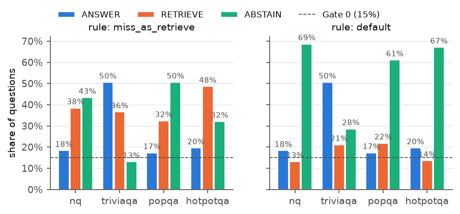

# Data, label rule and Gate 0 (gemma3-4b-it)

## Data: splits, holes and retrieval coverage

| split | n | hole | unanswerable | gold passage | BM25 has answer (non-hole) | BM25 has answer (hole) |
|---|---|---|---|---|---|---|
| pilot | 500 | 31.4% | 0.0% | 85.4% | 51.9% | 0.0% |
| nq_train | 4000 | 30.2% | 0.0% | 77.1% | 37.2% | 0.0% |
| nq_val | 500 | 30.8% | 0.0% | 75.6% | 35.0% | 0.0% |
| nq_test | 1000 | 30.9% | 0.0% | 80.6% | 37.6% | 0.0% |
| triviaqa_train | 4000 | 30.3% | 0.0% | 93.2% | 71.1% | 0.0% |
| triviaqa_val | 500 | 31.4% | 0.0% | 93.4% | 72.6% | 0.0% |
| triviaqa_test | 1000 | 28.3% | 0.0% | 92.7% | 71.4% | 0.0% |
| popqa_test | 1000 | 0.0% | 0.0% | 62.8% | 40.0% | - |
| hotpotqa_test | 1000 | 30.2% | 0.0% | 100.0% | 38.0% | 0.0% |
| selfaware_test | 500 | 0.0% | 100.0% | 0.0% | 0.0% | - |

CSV: `data.csv`

## Accuracy per condition (alias containment)

| split | closed | n closed | bm25 | n bm25 | gold | n gold |
|---|---|---|---|---|---|---|
| pilot | 35.4% | 500 | 29.6% | 500 | 75.2% | 427 |
| nq_train | 19.6% | 4000 | 20.2% | 4000 | 63.7% | 3085 |
| nq_val | 18.4% | 500 | 19.0% | 500 | 63.5% | 378 |
| nq_test | 18.3% | 1000 | 20.0% | 1000 | 63.6% | 806 |
| triviaqa_train | 52.2% | 4000 | 50.0% | 4000 | 84.0% | 3728 |
| triviaqa_val | 51.2% | 500 | 50.2% | 500 | 82.4% | 467 |
| triviaqa_test | 50.5% | 1000 | 50.8% | 1000 | 83.7% | 927 |
| popqa_test | 17.2% | 1000 | 34.1% | 1000 | 70.1% | 628 |
| hotpotqa_test | 19.5% | 1000 | 22.4% | 1000 | 63.8% | 1000 |
| selfaware_test | 0.0% | 500 | 0.0% | 500 | - | 0 |

CSV: `accuracy.csv`

## Label shares under both rules (main rule: miss_as_retrieve)

| split | rule | n | ANSWER | RETRIEVE | ABSTAIN | under 15% |
|---|---|---|---|---|---|---|
| pilot | miss_as_retrieve | 500 | 35.4% | 36.8% | 27.8% | - |
| pilot | default | 500 | 35.4% | 11.6% | 53.0% | RETRIEVE |
| nq_train | miss_as_retrieve | 4000 | 19.6% | 36.4% | 43.9% | - |
| nq_train | default | 4000 | 19.6% | 12.3% | 68.0% | RETRIEVE |
| nq_val | miss_as_retrieve | 500 | 18.4% | 37.6% | 44.0% | - |
| nq_val | default | 500 | 18.4% | 11.2% | 70.4% | RETRIEVE |
| nq_test | miss_as_retrieve | 1000 | 18.3% | 38.4% | 43.3% | - |
| nq_test | default | 1000 | 18.3% | 13.1% | 68.6% | RETRIEVE |
| triviaqa_train | miss_as_retrieve | 4000 | 52.2% | 34.9% | 12.9% | ABSTAIN |
| triviaqa_train | default | 4000 | 52.2% | 18.5% | 29.3% | - |
| triviaqa_val | miss_as_retrieve | 500 | 51.2% | 32.4% | 16.4% | - |
| triviaqa_val | default | 500 | 51.2% | 16.2% | 32.6% | - |
| triviaqa_test | miss_as_retrieve | 1000 | 50.5% | 36.5% | 13.0% | ABSTAIN |
| triviaqa_test | default | 1000 | 50.5% | 21.0% | 28.5% | - |
| popqa_test | miss_as_retrieve | 1000 | 17.2% | 32.3% | 50.5% | - |
| popqa_test | default | 1000 | 17.2% | 21.8% | 61.0% | - |
| hotpotqa_test | miss_as_retrieve | 1000 | 19.5% | 48.5% | 32.0% | - |
| hotpotqa_test | default | 1000 | 19.5% | 13.5% | 67.0% | RETRIEVE |
| selfaware_test | miss_as_retrieve | 500 | 0.0% | 0.0% | 100.0% | ANSWER, RETRIEVE |
| selfaware_test | default | 500 | 0.0% | 0.0% | 100.0% | ANSWER, RETRIEVE |

CSV: `labels.csv`

## What the rule change moves

| split | n | moved to RETRIEVE | moved share | ABSTAIN beyond_model | ABSTAIN retriever_miss | ABSTAIN unanswerable |
|---|---|---|---|---|---|---|
| pilot | 500 | 126 | 25.2% | 139 | 126 | 0 |
| nq_train | 4000 | 964 | 24.1% | 1757 | 964 | 0 |
| nq_val | 500 | 132 | 26.4% | 220 | 132 | 0 |
| nq_test | 1000 | 253 | 25.3% | 433 | 253 | 0 |
| triviaqa_train | 4000 | 656 | 16.4% | 516 | 656 | 0 |
| triviaqa_val | 500 | 81 | 16.2% | 82 | 81 | 0 |
| triviaqa_test | 1000 | 155 | 15.5% | 130 | 155 | 0 |
| popqa_test | 1000 | 105 | 10.5% | 505 | 105 | 0 |
| hotpotqa_test | 1000 | 350 | 35.0% | 320 | 350 | 0 |
| selfaware_test | 500 | 0 | 0.0% | 0 | 0 | 500 |

CSV: `rule_change.csv`

## Gate 0: each class >= 15%

| set | subset | rule | n | ANSWER | RETRIEVE | ABSTAIN | gate |
|---|---|---|---|---|---|---|---|
| pilot | all | miss_as_retrieve | 500 | 35.4% | 36.8% | 27.8% | PASS |
| pilot | all | default | 500 | 35.4% | 11.6% | 53.0% | FAIL |
| pilot | nq | miss_as_retrieve | 250 | 20.8% | 38.8% | 40.4% | PASS |
| pilot | nq | default | 250 | 20.8% | 10.4% | 68.8% | FAIL |
| pilot | triviaqa | miss_as_retrieve | 250 | 50.0% | 34.8% | 15.2% | PASS |
| pilot | triviaqa | default | 250 | 50.0% | 12.8% | 37.2% | FAIL |
| train (nq+triviaqa) | all | miss_as_retrieve | 8000 | 35.9% | 35.7% | 28.4% | PASS |
| train (nq+triviaqa) | all | default | 8000 | 35.9% | 15.4% | 48.7% | PASS |
| train (nq+triviaqa) | nq | miss_as_retrieve | 4000 | 19.6% | 36.4% | 43.9% | PASS |
| train (nq+triviaqa) | nq | default | 4000 | 19.6% | 12.3% | 68.0% | FAIL |
| train (nq+triviaqa) | triviaqa | miss_as_retrieve | 4000 | 52.2% | 34.9% | 12.9% | FAIL |
| train (nq+triviaqa) | triviaqa | default | 4000 | 52.2% | 18.5% | 29.3% | PASS |

CSV: `gate0.csv`

